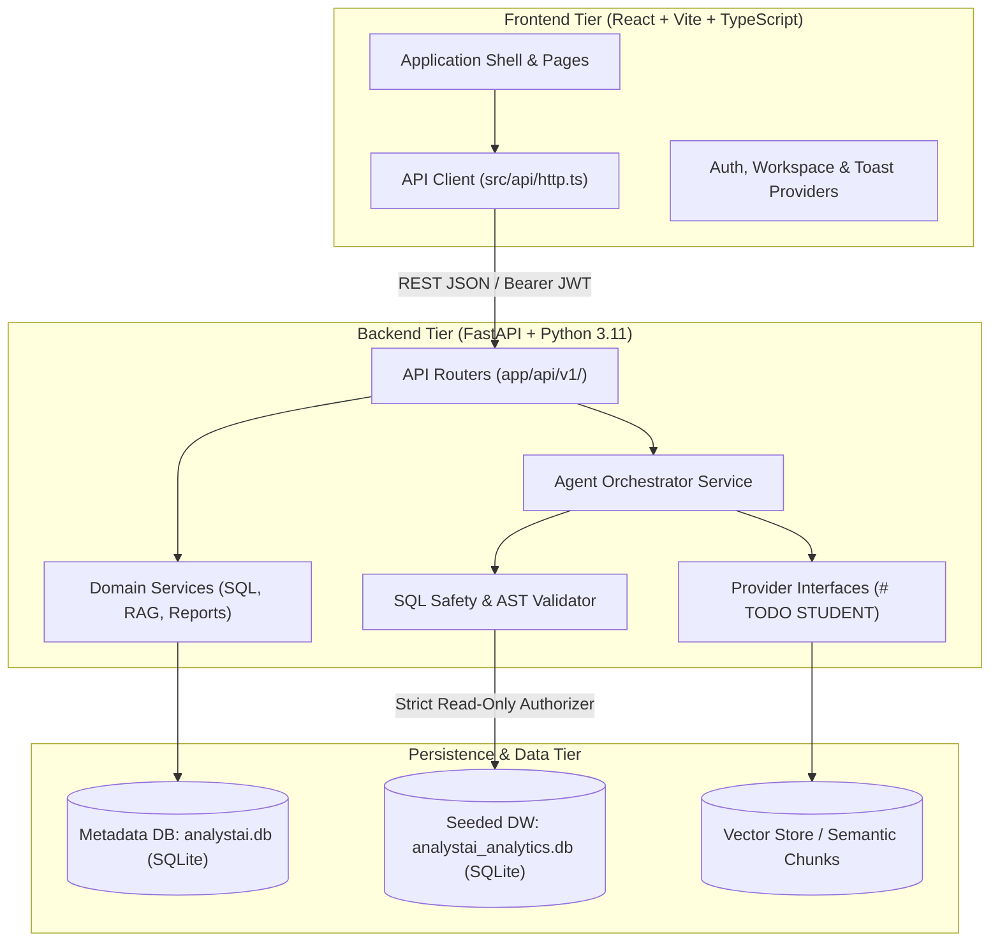
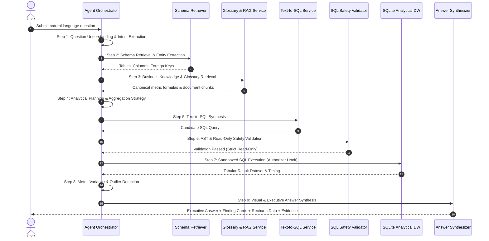

# AnalystAI — Technical Architecture & System Design

## 1. High-Level System Architecture

AnalystAI adopts a clean, decoupled three-tier architecture:

---

## 2. 9-Step Bounded Agent Orchestration Pipeline

Rather than relying on unconstrained, looping autonomous agents that risk hallucination and infinite token loops, AnalystAI uses a deterministic **9-step bounded sequential agent architecture**:

---

## 3. Dual-Layer SQL Safety Architecture

Database mutations and prompt-injection-driven data destruction are mitigated by two independent validation barriers:

1. **Layer 1: AST Parsing & Keyword Inspection (`sql_validation_service.py`)**
   - Strips SQL comments and checks syntax against a strict whitelist of SELECT statements.
   - Forbids multi-statement execution (semicolons separating multiple commands).
   - Rejects statements containing `DROP`, `INSERT`, `UPDATE`, `DELETE`, `ALTER`, `TRUNCATE`, `REPLACE`, `EXEC`, `CREATE`, `ATTACH`, `DETACH`.
2. **Layer 2: C-Level SQLite Authorizer Callback (`database_connector.py`)**
   - Configures `sqlite3.set_authorizer(sqlite_read_only_authorizer)` directly on the database connection.
   - Intercepts all SQLite engine opcodes before query execution:
     - Allows: `SQLITE_SELECT`, `SQLITE_READ`, `SQLITE_FUNCTION`.
     - Denies: `SQLITE_INSERT`, `SQLITE_UPDATE`, `SQLITE_DELETE`, `SQLITE_DROP_TABLE`, `SQLITE_ALTER_TABLE`, `SQLITE_ATTACH`, `SQLITE_PRAGMA`.

---

## 4. Frontend Component Hierarchy

The frontend follows modular feature-driven architecture:

- `src/components/layout/`:
  - `AppShell`: Responsive navigation container with collapsible sidebar.
  - `Sidebar`: 5-section navigation hierarchy (Workspace, Data, BI, Operations, Admin).
  - `Topbar`: Global search trigger, period selector, user avatar, and notification shortcut.
  - `CommandPalette`: `Ctrl+K` searchable modal.
- `src/components/ui/`: Standard design tokens including `Button`, `Card`, `StatCard`, `ChartCard`, `Dialog`, `Tabs`, `Badge`, `Skeleton`, `EmptyState`.
- `src/features/`: Dedicated screen implementations for Auth, Onboarding, Overview, AI Analyst, Data Sources, Data Explorer, SQL Workspace, Knowledge Base, Glossary, Dashboards, Reports, Schedules, Agent Runs, Team, Settings, and Audit Logs.
