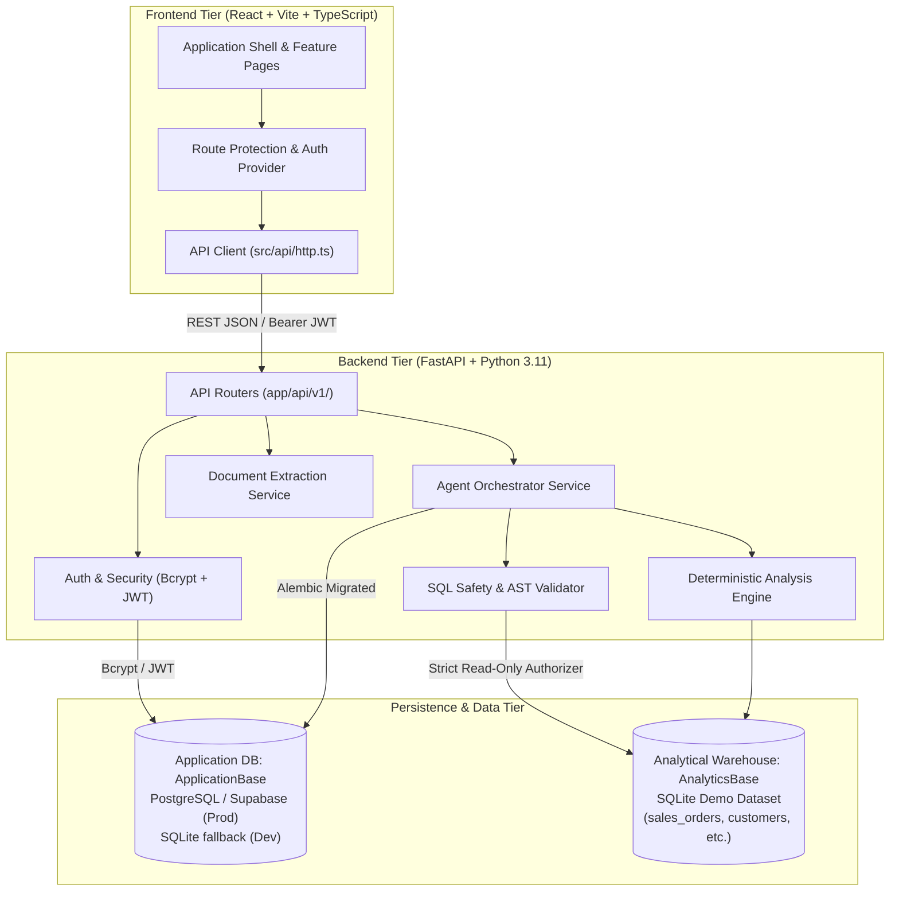
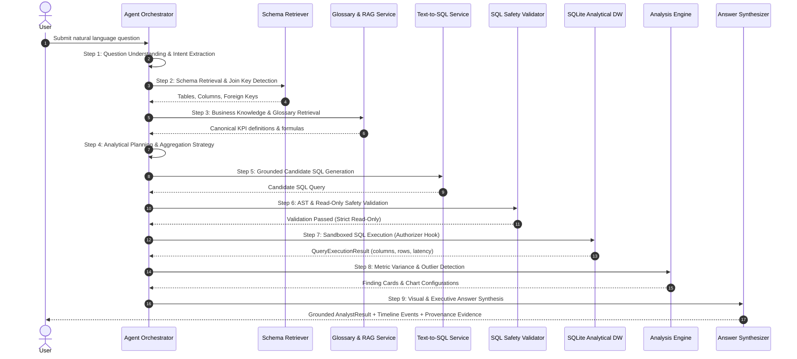

# AnalystAI — Technical Architecture & System Design

## 1. High-Level System Architecture

AnalystAI adopts a clean, decoupled three-tier architecture with distinct responsibilities for application metadata versus customer analytical data:

---

## 2. Dual-Engine Database Architecture

A central design improvement is the strict physical and logical separation of the application's operational metadata from customer/analytical business data:

### A. Application Metadata Database (`ApplicationBase`)
- **Engine:** Configured via `DATABASE_URL` (PostgreSQL / Supabase in production, local SQLite fallback in development).
- **ORM Metadata:** Managed exclusively by `ApplicationBase.metadata`.
- **Schema Management:** Owned entirely by **Alembic** migrations (`backend/migrations/`).
- **Entities:**
  - `User`: Accounts, hashed credentials (bcrypt), roles (Admin, Analyst, Viewer).
  - `Workspace` & `WorkspaceSetting`: Multi-tenant workspace configuration and AI provider preferences.
  - `DataSource` & `UploadedDataset`: Registered connector configs and metadata.
  - `AgentRun` & `AgentRunEvent`: 9-step timeline events, generated queries, and structured results.
  - `QueryHistory` & `SavedQuery`: User SQL workspace execution audit trail.
  - `KnowledgeDocument` & `DocumentChunk`: Uploaded documents, chunked text, and RAG metadata.
  - `GlossaryTerm`: Canonical business KPI definitions, formulas, and domain mappings.
  - `Dashboard`, `Report`, `ScheduledJob`, `Notification`, `AuditEvent`: Operational business intelligence objects.

### B. Analytical Customer Warehouse (`AnalyticsBase`)
- **Engine:** Configured via `ANALYTICS_DATABASE_URL` (defaults to `./data/analystai_analytics.db`).
- **ORM Metadata:** Defined in `AnalyticsBase.metadata`, isolated from Alembic application migrations.
- **Access Lifecycle:** Accessed via `SqliteDemoConnector` and future external connectors (`PostgresConnector`, `SnowflakeConnector`).
- **Entities:**
  - `SalesOrder`: 200 historical transaction records across 2026.
  - `Customer`: Customer demographics, segments, and churn risk scores.
  - `Product`: Catalog items, prices, costs, and standard margins.
  - `Region`: Regional sales targets and leadership hierarchy.

---

## 3. 9-Step Bounded Agent Orchestration Pipeline

Rather than relying on unconstrained, looping autonomous agents that risk hallucination and infinite token loops, AnalystAI uses a bounded, transparent **9-step sequential agent pipeline**:

### Truthful Analytical Guarantee
- **No Fabricated Fallback Rows:** If query execution returns 0 rows, the system reports 0 rows with an honest empty state (`"No data records matched your query parameters"`).
- **Connector Enforcement:** If an unconfigured or scaffolded external connector is targeted, execution fails honestly with an error message instead of silently querying SQLite.
- **Grounded Evidence:** Evidence items cite actual referenced database tables, retrieved glossary definitions, and verified execution latencies.

---

## 4. Dual-Layer SQL Safety Architecture

Database mutations and prompt-injection attacks are mitigated by two independent validation layers:

1. **Layer 1: AST Parsing & Keyword Inspection (`sql_validation_service.py`)**
   - Strips SQL comments and checks syntax against a strict whitelist of SELECT statements.
   - Forbids multi-statement execution (semicolons separating multiple commands).
   - Rejects statements containing `DROP`, `INSERT`, `UPDATE`, `DELETE`, `ALTER`, `TRUNCATE`, `REPLACE`, `EXEC`, `CREATE`, `ATTACH`, `DETACH`.
2. **Layer 2: C-Level SQLite Authorizer Callback (`sqlite_demo_connector.py`)**
   - Configures `sqlite3.set_authorizer(sqlite_read_only_authorizer)` directly on the database connection.
   - Intercepts all SQLite engine opcodes before query execution:
     - Allows: `SQLITE_SELECT`, `SQLITE_READ`, `SQLITE_FUNCTION`.
     - Denies: `SQLITE_INSERT`, `SQLITE_UPDATE`, `SQLITE_DELETE`, `SQLITE_DROP_TABLE`, `SQLITE_ALTER_TABLE`, `SQLITE_ATTACH`, `SQLITE_PRAGMA`.

---

## 5. Authentication & Authorization Architecture

- **Password Hashing:** Implemented with adaptive **bcrypt** (`bcrypt.hashpw` + `bcrypt.gensalt()`).
- **Legacy Migration:** Backward-compatible verification for existing salted SHA-256 hashes (`sha256$salt$hash`), with automatic re-hashing to bcrypt upon successful login.
- **JWT Signing:** Access tokens signed via HS256 with cryptographically validated expiration (`exp`), subject (`sub`), and role claims.
- **Frontend Route Protection:** `AppShell` enforces active authentication state. Unauthenticated requests are redirected to `/login` without granting fake administrative access.

---

## 6. Document & RAG Pipeline Architecture

- **File Upload Guardrails:** Upload size capped at `MAX_UPLOAD_MB` (default 20MB). Extension and MIME type validated. Filenames sanitized against path traversal using UUID prefixes and `os.path.basename`.
- **Extraction Adapters:**
  - **TXT:** Direct UTF-8 decode with fallback.
  - **CSV:** Parsed using `pandas.read_csv()` with structural dimension summary.
  - **XLSX:** Parsed using `pandas.read_excel()` with preview sampling.
  - **PDF:** Text extracted via `pypdf`. Empty/image-only PDFs return an explicit notice requiring OCR.
  - **DOCX:** Explicitly reports unsupported status until a document converter is configured.
- **Chunking:** Chunked into bounded overlapping character windows (default 500 characters, 50 overlap) with positional metadata.
